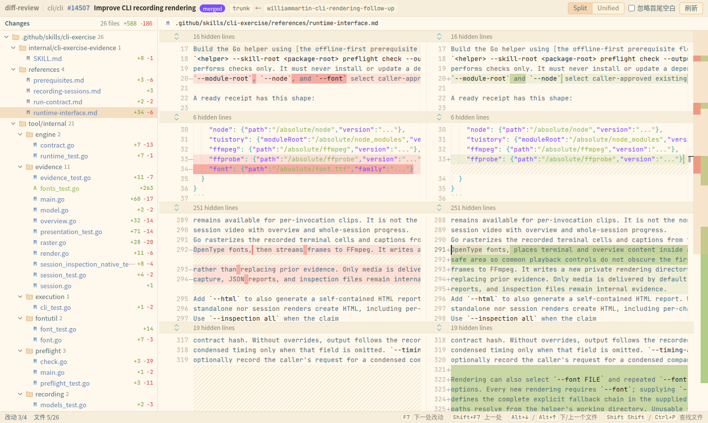

<h1 align="center">🌊 Tideline</h1>

<p align="center">
  <b>Give it a GitHub PR link and see a JetBrains-style diff in your browser within seconds. No clone, no IDE.</b>
</p>

<p align="center">
  
  
  
  
</p>

<p align="center">
  
</p>

> *Tideline*: the line the tide leaves on the sand, marking where things changed.

## Why

Reviewing a sizeable PR on github.com is tiring:

- You only see hunks. Getting more context means clicking "expand" over and over.
- Large files start collapsed, and big PRs get sluggish.
- Keyboard navigation is weak.

JetBrains IDEs review PRs much better, but first you have to clone the repo, open the project and wait for indexing.

Tideline sits in between:

- It runs a small local server that uses a partial clone to fetch only the commits and blobs the PR touches.
- It renders full-file diffs in your browser with Monaco, the editor behind VS Code.

## Features

**Diff view**
- **Full-file diffs**: switch between side-by-side and unified. Unchanged regions collapse and expand on click.
- **Word-level highlighting**: the changed words within a line are marked.
- **Whitespace**: optionally ignore leading/trailing whitespace.
- **Move detection**: a block that moved shows as moved, not as a deletion plus an addition.

**JetBrains-style keyboard**
- `F7` / `Shift+F7`: next/previous change. At the end of a file it continues into the next file.
- `Alt+↓` / `Alt+↑`: next/previous file.
- `Shift Shift` or `Ctrl+P`: fuzzy file finder.

**Changes tree**
- Grouped by directory, with single-child chains merged into one row.
- Status colors and `+/-` line counts.
- Generated files (lockfiles, `linguist-generated`, …) go in their own group, collapsed by default.

**Special files**
- Images are compared side by side.
- Submodule bumps show as `Subproject commit a → b`.
- Large, minified and binary files degrade gracefully instead of freezing the page.

**Fast and lean**
- The first open does a shallow fetch of just two commits, then one batched download of the changed blobs. The whole repo is never cloned.
- Reopening a PR you have already opened shows the diff in about 0.1 s.

**Theme**: [Material Theme UI](https://www.material-theme.com/)'s Sandy Beach palette, with JetBrains Mono for code.

**Security**: see [Security model](#security-model) below.
- The server only listens on localhost.
- Your GitHub token never leaves the server.
- Other websites and other local users can't reach your private repos.

## Install

Requirements:
- Rust (stable)
- git ≥ 2.40
- Node.js and pnpm (to build the frontend)

```bash
git clone https://github.com/CherryLemon/gh-tideline.git
cd gh-tideline
make build                                  # builds the frontend, then cargo build --release
cp target/release/gh-tideline ~/.local/bin/ # or any directory on your PATH
```

The result is a single binary with the web UI embedded.

> Prebuilt releases are not published yet. Once they are, `gh extension install CherryLemon/gh-tideline` will install it and you can run it as `gh tideline`.

## Usage

```bash
gh-tideline https://github.com/owner/repo/pull/123   # a /files suffix etc. also works
gh-tideline owner/repo#123
gh-tideline 123                                      # inside a clone; the repo is taken from origin
gh-tideline                                          # opens the home page, where you can paste a PR link
```

**Authentication**
- The token comes from `GH_TOKEN`, then `GITHUB_TOKEN`, then `gh auth token`. If you are logged in to the gh CLI, there is nothing to configure.
- For GitHub Enterprise, use `GH_ENTERPRISE_TOKEN` and allowlist the host in the config file:

```toml
# ~/.config/tideline/config.toml (optional)
port = 7457
ghe_hosts = ["github.example.com"]
```

**Tip:** local URLs mirror GitHub paths. Replace `https://` in a PR link with `http://localhost:7457/` and it opens in Tideline. As a bookmarklet:

```js
javascript:location.href='http://localhost:7457/'+location.host+location.pathname
```

## Security model

The local server holds your GitHub token, so it treats every website and every other local process as untrusted.

| Threat | Mitigation |
|---|---|
| A website reaches the server through DNS rebinding | Listens only on `127.0.0.1` and checks the `Host` header |
| A website reads API responses | No CORS headers; `/api` accepts only same-origin requests carrying a custom header |
| The server is tricked into sending the token to another host | The host in the URL must be github.com or a GHE host listed in the config |
| Another local user or process impersonates the server | The CLI signs auth links locally: single-use, valid for 60 s, bound to the port. The secret never goes over the network |
| A malicious SVG or HTML file in a PR runs script on the app's origin | Blobs are always served as `octet-stream` with `nosniff` and `CSP: sandbox`; SVGs are converted to PNG on a canvas before display |
| Other users read cached private code | Cache and config directories are `0700`; the secret file is `0600` |
| The token shows up in the process list | It reaches git through `GIT_CONFIG_*` environment variables, never command-line arguments, and git gets only an allowlisted environment |

## Roadmap

- [x] **M0 – read diffs**: everything in this README.
- [ ] **M1 – review context**
  - Viewed-file state synced both ways with GitHub
  - Existing review threads
  - Per-commit and commit-range views
  - "Since my last review", showing only the author's own changes even after a rebase
- [ ] **M2 – code navigation**
  - tree-sitter based go to definition and find usages
  - Sticky header showing the current function or class

Design details are in [`docs/design.md`](docs/design.md); the M0 implementation contract is in [`docs/m0-skeleton.md`](docs/m0-skeleton.md). Both are in Chinese.

## Development

```bash
make test    # cargo test + the frontend's vitest
make dev     # prints the dev workflow
```

1. **Terminal 1:** run `cargo run -- --no-open`. The backend listens on `127.0.0.1:7457` and prints a one-time auth link.
2. **Terminal 2:** run `cd web && pnpm dev`. Vite runs on port 5173 and proxies `/api` and `/__auth` to the backend.
3. **In the browser:** open the auth link, then go to `http://localhost:5173/`.

- **Without a backend:** run `pnpm dev:mock` to work on the UI against a built-in fake PR.
- **After frontend changes:** debug builds read `web/dist` from disk, so the result of `pnpm build` shows up without recompiling the backend.

## License

[MIT](LICENSE) © 2026 CherryLemon
