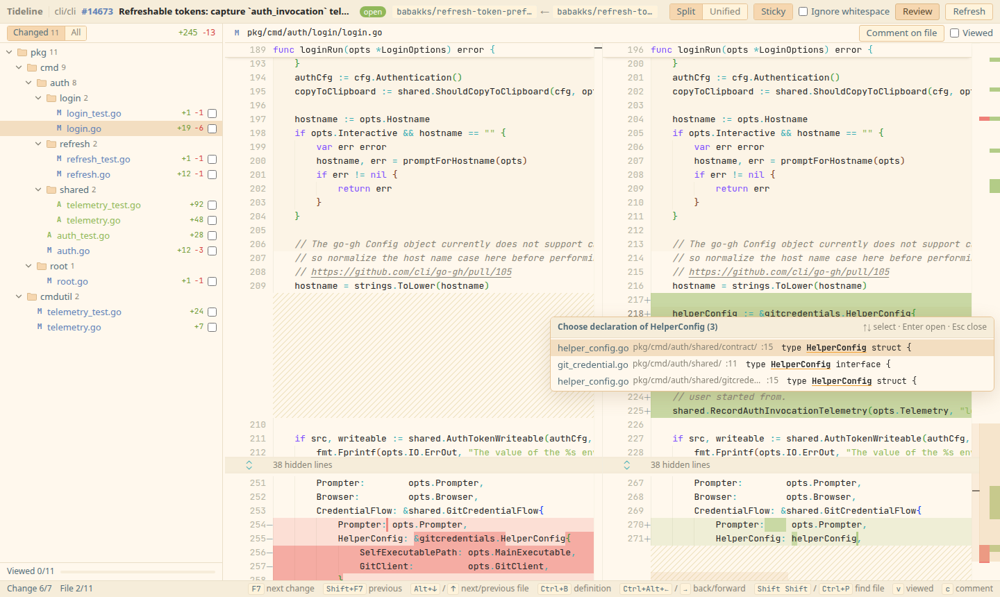

<h1 align="center">🌊 Tideline</h1>

<p align="center">
  <b>Give it a GitHub PR link and see a JetBrains-style diff in your browser within seconds. No clone, no IDE.</b>
</p>

<p align="center">
  
  
  
  
</p>

<p align="center">
  
</p>

> *Tideline*: the line the tide leaves on the sand, marking where things changed.

## Why

Reviewing a sizeable PR on github.com is tiring:

- You only see hunks. Getting more context means clicking "expand" over and over.
- Large files start collapsed, and big PRs get sluggish.
- Keyboard navigation is weak.

JetBrains IDEs review PRs much better, but first you have to clone the repo, open the project and wait for indexing.

Tideline sits in between:

- It runs a small local server that uses a partial clone to fetch only the commits and blobs the PR touches.
- It renders full-file diffs in your browser with Monaco, the editor behind VS Code.

## Features

**Diff view**
- **Full-file diffs**: switch between side-by-side and unified. Unchanged regions collapse and expand on click.
- **Word-level highlighting**: the changed words within a line are marked.
- **Whitespace**: optionally ignore leading/trailing whitespace.
- **Move detection**: a block that moved shows as moved, not as a deletion plus an addition.

**Reviewing**
- **Review threads in the diff**: existing threads sit under the lines they are about, on their side. File-level, outdated and unplaceable threads sit above the editor; resolved ones stay collapsed.
- **Comment as on github.com**: click or drag the `+` in the gutter (old lines in split view), press `c`, or comment on a whole file. Start a review (comments stay pending until you submit) or add a single comment.
  Reply, resolve, and edit or delete your own comments.
- **Submit the review**: Comment, Approve or Request changes, with a summary. It warns when the pending review was started on an older commit.
- **Markdown preview**, rendered by GitHub so it looks exactly as it will on the PR.
- **Drafts survive a reload**: unsent text is kept per tab. Pending comments live on GitHub, so a review started here can be finished on github.com and the other way round.
- **Viewed marks** sync both ways with GitHub. `v` marks the file and moves to the next unviewed one.

**Code navigation**
- **Go to definition**: `Ctrl+B` on a name, or `Ctrl+click` on it (`Cmd+click` on macOS). The name under the pointer is underlined while `Ctrl` is held; keywords, and names in comments and strings, are not links. One definition opens at its line, and several are listed to choose from, nearest first. A file the PR changes opens as a diff; any other file opens read-only from the head tree.
- **Usages**: `Ctrl+click` or `Ctrl+B` on the name of a definition itself lists the places that use it, with the line of each. Names are matched, not resolved by type, and the list says "matched by name".
- **Back and forward**: `Ctrl+Alt+←` / `Ctrl+Alt+→` step through the places you visited, as in JetBrains. Every jump is a browser history entry, so the browser's Back and Forward work too and return to the caret. GNOME and KDE may take `Ctrl+Alt+←/→` for switching workspaces; the browser's keys still work there.
- **Sticky header**: the functions and classes around the first visible line (up to four, fewer in a short editor or where a bar of collapsed unchanged lines is near the top) stay pinned at the top of each editor, and a click on a row goes to it. The **Sticky** button in the top bar turns it off.
- **Built on the first jump**, not when a PR opens: tree-sitter indexes the source files of the PR's head (and of its merge base, when you jump from the old side) behind a dialog that shows progress and can be cancelled with `Esc`. The index is kept per file content, so another PR in the same repo only indexes what is new. It is stored in `index.sqlite` in the cache directory, and nothing is evicted yet.
- **Languages**: Rust, Go, Python, TypeScript/TSX, JavaScript, Java, C and C++ (a `.h` file is C++ when its content says so).
- **Speed**: the first index of cli/cli takes about 4 s, and that of microsoft/vscode (15,000 source files) less than a minute. A lookup takes milliseconds.

<p align="center">
  
</p>

**JetBrains-style keyboard**
- `F7` / `Shift+F7`: next/previous change. At the end of a file it continues into the next file.
- `Alt+↓` / `Alt+↑`: next/previous file.
- `Shift Shift` or `Ctrl+P`: fuzzy file finder.
- `Ctrl+B` / `Ctrl+click`: go to definition; on a definition's own name, its usages. `Ctrl+Alt+←` / `Ctrl+Alt+→`: back / forward.
- `v`: mark the file as viewed; `c`: comment on the current line or selection; `Ctrl+Enter`: send a comment or submit the review.

**Changes tree**
- Grouped by directory, with single-child chains merged into one row.
- Status colors and `+/-` line counts, plus a thread badge: unresolved threads in the accent color, or the total in grey once all are resolved.
- Generated files (lockfiles, `linguist-generated`, …) go in their own group, collapsed by default.
- **All** shows the full project tree at the head, so you can open any file for context.

**Special files**
- Images are compared side by side.
- Submodule bumps show as `Subproject commit a → b`.
- Large, minified and binary files degrade gracefully instead of freezing the page.

**Fast and lean**
- The first open does a shallow fetch of just two commits, then one batched download of the changed blobs. The whole repo is never cloned.
- Reopening a PR you have already opened shows the diff in about 0.1 s.

**Theme**: [Material Theme UI](https://www.material-theme.com/)'s Sandy Beach palette, with JetBrains Mono for code.

**Security**: see [Security model](#security-model) below.
- The server only listens on localhost.
- Your GitHub token never leaves the server.
- Other websites and other local users can't reach your private repos.

## Install

Tideline needs git ≥ 2.40 at runtime. Prebuilt binaries are available for Linux and macOS (amd64 and arm64). Windows is not supported yet.

**As a gh extension (recommended)**

```bash
gh extension install CherryLemon/gh-tideline
gh extension upgrade tideline   # later, to update
```

**Standalone binary:** download `gh-tideline-<os>-<arch>` from [Releases](https://github.com/CherryLemon/gh-tideline/releases), make it executable and put it on your PATH.

**From source:** requires Rust (stable), Node.js and pnpm.

```bash
git clone https://github.com/CherryLemon/gh-tideline.git
cd gh-tideline
make build                                  # builds the frontend, then cargo build --release
cp target/release/gh-tideline ~/.local/bin/ # or any directory on your PATH
```

Either way, you get a single binary with the web UI embedded.

## Usage

Run it as `gh tideline` when installed as an extension, or as `gh-tideline` otherwise.

```bash
gh tideline https://github.com/owner/repo/pull/123   # a /files suffix etc. also works
gh tideline owner/repo#123
gh tideline 123                                      # inside a clone; the repo is taken from origin
gh tideline                                          # opens the home page, where you can paste a PR link
```

**Authentication**
- The token comes from `GH_TOKEN`, then `GITHUB_TOKEN`, then `gh auth token`. If you are logged in to the gh CLI, there is nothing to configure.
- For GitHub Enterprise, use `GH_ENTERPRISE_TOKEN` and allowlist the host in the config file:

```toml
# ~/.config/tideline/config.toml (optional)
port = 7457
ghe_hosts = ["github.example.com"]
```

**Tip:** local URLs mirror GitHub paths. Replace `https://` in a PR link with `http://localhost:7457/` and it opens in Tideline. As a bookmarklet:

```js
javascript:location.href='http://localhost:7457/'+location.host+location.pathname
```

## Security model

The local server holds your GitHub token, so it treats every website and every other local process as untrusted.

| Threat | Mitigation |
|---|---|
| A website reaches the server through DNS rebinding | Listens only on `127.0.0.1` and checks the `Host` header |
| A website reads API responses | No CORS headers; `/api` accepts only same-origin requests carrying a custom header |
| The server is tricked into sending the token to another host | The host in the URL must be github.com or a GHE host listed in the config |
| Another local user or process impersonates the server | The CLI signs auth links locally: single-use, valid for 60 s, bound to the port. The secret never goes over the network |
| A malicious SVG or HTML file in a PR runs script on the app's origin | Blobs are always served as `octet-stream` with `nosniff` and `CSP: sandbox`; SVGs are converted to PNG on a canvas before display |
| A comment's HTML runs script, or leaks the local URL to the sites it links or loads images from | GitHub's rendered HTML is sanitized with DOMPurify (no styles, forms or frames; `https:` links only), and the app page has a strict Content-Security-Policy and `Referrer-Policy: no-referrer` |
| A website posts comments or reviews in your name | Writes need the session cookie, a same-origin `Origin` and the custom header, like every other API call |
| Other users read cached private code | Cache and config directories are `0700`; the secret file and the code navigation index (`index.sqlite`) are `0600` |
| A line of source in a popup list or the sticky header runs as markup | Both show repository text as text. The colors of the sticky header are read from Monaco's output through an inert `DOMParser` document, keeping only the text and its token classes |
| The token shows up in the process list | It reaches git through `GIT_CONFIG_*` environment variables, never command-line arguments, and git gets only an allowlisted environment |

## Roadmap

- [x] **M0 – read diffs** (v0.1.0)
- [x] **M1 – review context** (v0.2.0): viewed state synced with GitHub, the full project tree
- [x] **M2 – review threads and writing** (v0.3.0): threads in the diff, comments, replies, resolving, submitting reviews, Markdown preview
- [x] **M3 – code navigation** (v0.4.0): tree-sitter based go to definition and usages (`Ctrl+B` / `Ctrl+click`), a sticky header with the enclosing function or class, back / forward through visited locations (`Ctrl+Alt+←` / `Ctrl+Alt+→`)
- [ ] **Later**
  - Per-commit and commit-range views
  - "Since my last review", showing only the author's own changes even after a rebase

Design details are in [`docs/design.md`](docs/design.md).

## Development

```bash
make test    # cargo test + the frontend's vitest
make dev     # prints the dev workflow
```

1. **Terminal 1:** run `cargo run -- --no-open`. The backend listens on `127.0.0.1:7457` and prints a one-time auth link.
2. **Terminal 2:** run `cd web && pnpm dev`. Vite runs on port 5173 and proxies `/api` and `/__auth` to the backend.
3. **In the browser:** open the auth link, then go to `http://localhost:5173/`.

- **Without a backend:** run `pnpm dev:mock` to work on the UI against a built-in fake PR.
- **After frontend changes:** debug builds read `web/dist` from disk, so the result of `pnpm build` shows up without recompiling the backend.

**Releasing:** bump `version` in `Cargo.toml` (and `Cargo.lock` via `cargo check`) and in `web/package.json`, commit, then push a matching tag such as `v0.4.0`. The [release workflow](.github/workflows/release.yml) tests, builds the binaries and publishes the GitHub release.

## License

[MIT](LICENSE) © 2026 CherryLemon
